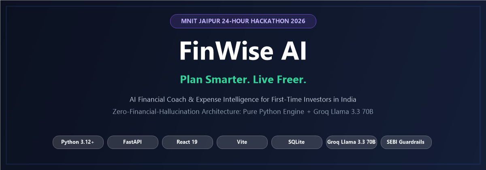
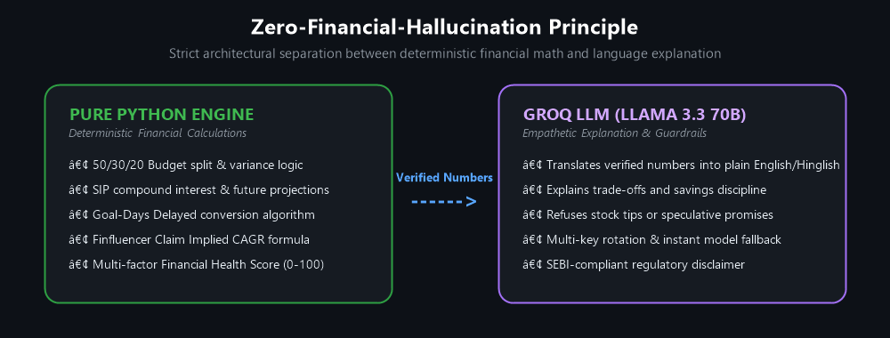
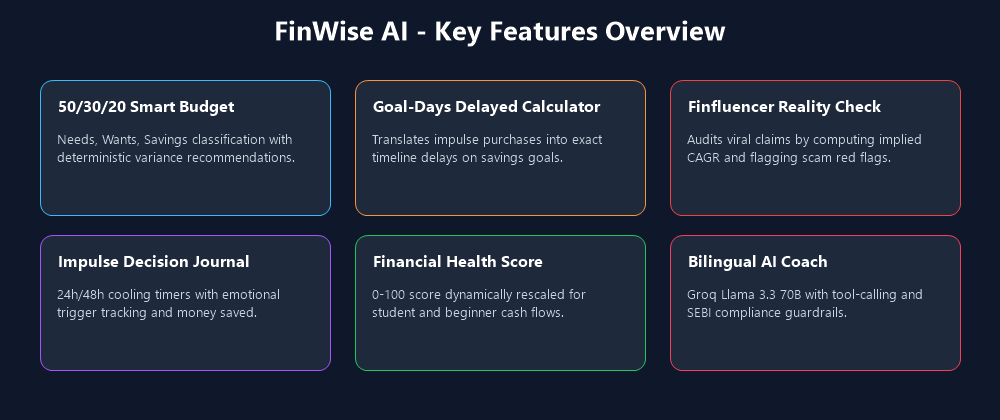
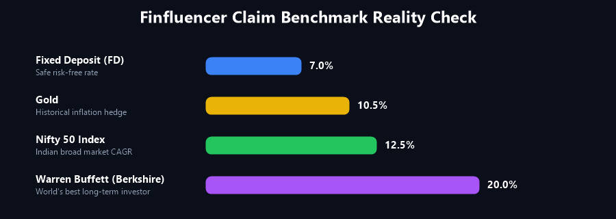
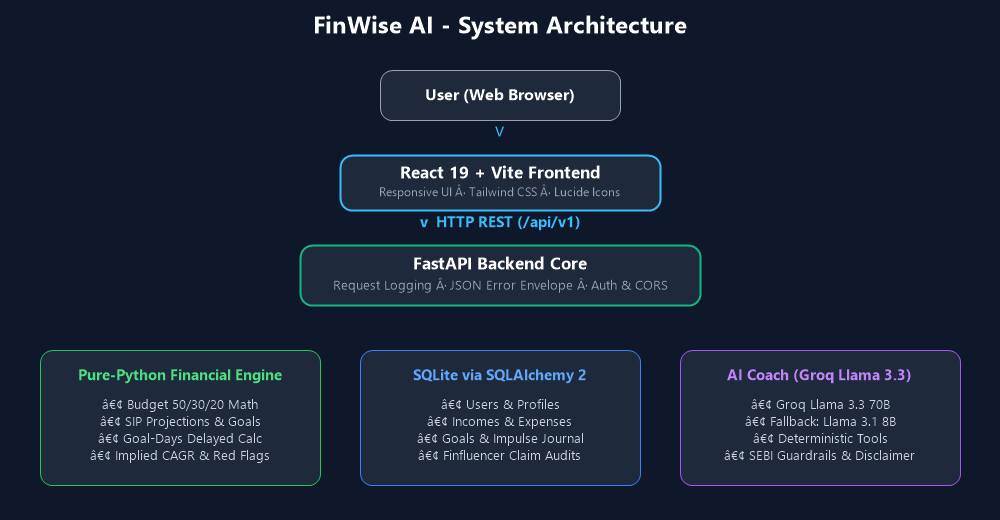
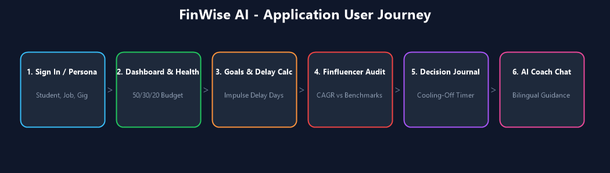
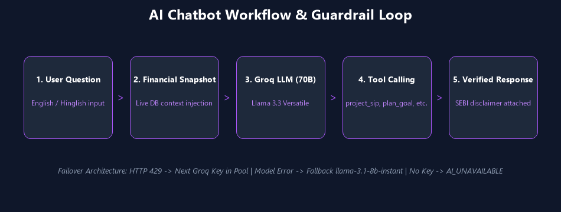
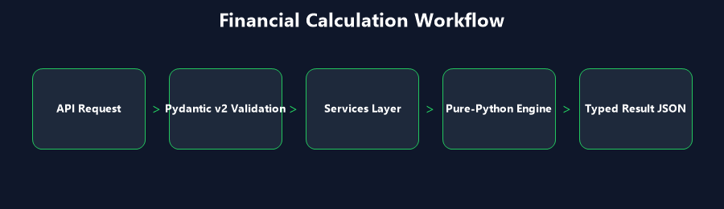
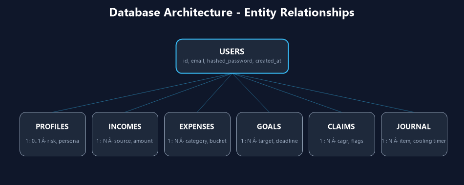
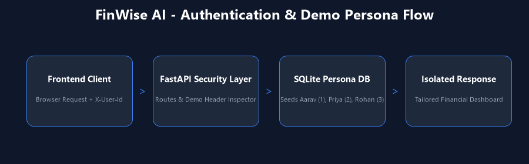

<div align="center">



# 🪙 FinWise AI

### Plan Smarter. Live Freer.

**AI financial coach and expense intelligence for first-time investors in India.**  
*Built for the MNIT Jaipur 24-Hour Hackathon 2026.*

[](https://python.org)
[](https://fastapi.tiangolo.com)
[](https://react.dev)
[](https://vitejs.dev)
[](https://sqlite.org)
[](https://groq.com)

[Features](#-key-features) · [Architecture](#-system-architecture) · [AI Coach](#-ai-architecture) · [Financial Engine](#-financial-calculation-engine) · [Setup (Windows)](#-installation-windows)

</div>

---

## 📑 Table of Contents

1. [About](#-about-finwise-ai)
2. [Problem and Solution](#-problem-and-solution)
3. [Target Audience](#-target-audience)
4. [Key Features](#-key-features)
5. [Product Tour](#-product-tour)
6. [System Architecture](#-system-architecture)
7. [User Journey](#-user-journey)
8. [AI Architecture](#-ai-architecture)
9. [Financial Calculation Engine](#-financial-calculation-engine)
10. [Database Architecture](#-database-architecture)
11. [Authentication](#-authentication)
12. [Market Data](#-market-data-integration)
13. [API Reference](#-api-reference)
14. [Project Structure](#-project-structure)
15. [Technology Stack](#-technology-stack)
16. [Environment Variables](#-environment-variables)
17. [Installation (Windows)](#-installation-windows)
18. [Testing](#-testing)
19. [Security and Privacy](#-security-and-privacy)
20. [Financial Disclaimer](#-financial-disclaimer)
21. [Known Limitations](#-known-limitations)
22. [Contributing](#-contributing)
23. [License](#-license)

---

## 💡 About FinWise AI

FinWise AI is a personal finance platform for young Indian earners. It helps users understand their money, question viral financial claims, and make disciplined decisions about spending and investing.

> **Don't just track your money. Understand it, question viral claims, and decide with discipline.**

## 🎯 Problem and Solution

**Problem.** Many first-time earners start investing from social-media promises and impulse spending, without a budget, an emergency fund, or a way to check whether a promised return is realistic.

**Solution.** FinWise combines two things:
1. **Deterministic engines** written in pure Python do all financial math: budget split, SIP growth, goal timelines, health score and claim CAGR.
2. **An LLM coach** (Groq, Llama 3.3 70B) explains the results in English or Hinglish. It receives verified numbers and is instructed not to invent figures or give individual stock tips.

This is the **Zero-Financial-Hallucination principle**: the model explains, the code calculates.

<p align="center">
  
</p>

## 👥 Target Audience

| Persona | Example challenge |
|---|---|
| 🎓 College students | Stipend or pocket money, no savings habit |
| 💻 First-job professionals | First salary, high discretionary spending |
| 🎨 Gig workers and freelancers | Irregular monthly income |
| 📈 First-time investors | Unsure which claims and returns are realistic |

## ✨ Key Features

<p align="center">
  
</p>

| Feature | What it does |
|---|---|
| ✅ **50/30/20 Smart Budgeting** | Classifies expenses into Needs / Wants / Savings and gives deterministic variance suggestions |
| ✅ **Expense Tracker** | Logs expenses that feed the budget |
| ✅ **Goal-Days Delayed Calculator** ⭐ | Converts a purchase into delay on a goal, e.g. "a ₹4,500 purchase delays your Emergency Fund by 25 days" |
| ✅ **SIP Simulator** | Projects SIP growth with deterministic Python; also available to the coach as `project_sip` |
| ✅ **Loan Management** | Loan management with EMI calculations |
| ✅ **Finfluencer Claim Reality Check** | Computes the implied CAGR of a claim, benchmarks it and flags scam signals |
| ✅ **Impulse Decision Journal** | 24h / 48h cooling-off timer, trigger tracking, money saved from avoided purchases |
| ✅ **Financial Health Score (0-100)** | 5 weighted factors with dynamic weight rescaling |
| ✅ **Market Intelligence** | Market data and news through configurable providers |
| ✅ **AI Financial Coach** | Groq-powered, English and Hinglish, tool-calling, SEBI-style guardrails |
| ✅ **Registration and Login** | User accounts, plus a seeded demo mode |

<details>
<summary><b>Feature details</b></summary>

**Finfluencer Claim Reality Check.** Benchmarks used:

<p align="center">
  
</p>

| Benchmark | Annual return |
|---|---:|
| Nifty 50 | 12.5% |
| Fixed Deposit | 7% |
| Gold | 10.5% |
| Warren Buffett | 20% |

Red flags detected: promised "guaranteed" returns, urgency / FOMO language, and VIP Telegram or WhatsApp tip channels.

**Impulse Decision Journal.** Users log a planned purchase, start a 24h or 48h cooling-off timer, and record the trigger (`fomo`, `excited`, `stressed`). The journal tracks cumulative money saved by avoiding purchases.

**Financial Health Score.** Factors: savings rate, emergency fund buffer, needs ratio, wants discipline and goal progress. Weights rescale so beginners are not penalised for not having investments yet.

**AI Coach.** Automatic model fallback, multi-key rotation on rate limits, and an offline mode where calculators keep working without an API key.

</details>

## 📸 Product Tour

| Screen | What it shows |
|---|---|
| Dashboard | 50/30/20 breakdown and Health Score |
| Goals | Impulse spend converted into days of delay |
| Finfluencer Audit | Implied CAGR against benchmarks, with red flags |
| Decision Journal | Live cooling-off countdown and money saved |
| AI Coach | Hinglish chat that calls calculator tools |

<!-- Add screenshots to docs/screenshots/ and uncomment:


-->

## 🏗 System Architecture

<p align="center">
  
</p>

<details>
<summary>Text version</summary>

```text
User
 │
 ▼
React + Vite frontend
 │   HTTP /api/v1
 ▼
FastAPI backend (request logging, JSON error envelope)
 │
 ├──► Services layer ──► Pure-Python financial engine
 │         │               budget · sip · goals · goal_delay
 │         │               claim_math · red_flags · health_score
 │         ▼
 │      SQLite (SQLAlchemy)
 │
 ├──► AI coach (Groq client, guardrails, tools)
 │         ├──► Groq: llama-3.3-70b-versatile
 │         └──► tool calls ──► Pure-Python financial engine
 │
 └──► Market data providers: tapetide · bharatstock · alphavantage · demo
```

</details>

## 🧭 User Journey

<p align="center">
  
</p>

<details>
<summary>Text version</summary>

```text
Sign in, or pick a demo persona
        │
        ▼
Dashboard: 50/30/20 budget + Health Score
        │
        ▼
Goals: enter an impulse spend ──► Goal-Days Delayed result
        │
        ▼
Finfluencer Audit: paste a claim ──► CAGR vs benchmarks + red flags
        │
        ▼
Decision Journal: 24h / 48h cooling-off timer
        │
        ▼
AI Coach (English / Hinglish) ──► answer with real numbers + disclaimer
```

</details>

## 🤖 AI Architecture

| Item | Value |
|---|---|
| Provider | Groq (`LLM_PROVIDER=groq`) |
| Primary model | `llama-3.3-70b-versatile` |
| Fallback model | `llama-3.1-8b-instant` |
| Request timeout | 20 seconds (`LLM_TIMEOUT_SECONDS`) |
| Key pool | Multi-key rotation via `GROQ_API_KEYS`, used on rate limits (HTTP 429) |
| Tools | `project_sip`, `plan_goal`, `get_budget_summary` (multi-round, allow-listed) |
| Guardrails | Refuses individual stock tips and speculative promises; ends with a SEBI-style disclaimer |
| Languages | English and Hinglish |
| Offline mode | Without an API key the backend still boots; AI endpoints return `AI_UNAVAILABLE` |

<p align="center">
  
</p>

<details>
<summary>Text version</summary>

```text
User question (English / Hinglish)
   │
   ▼
Build the user's financial snapshot
   │
   ▼
System prompt + SEBI guardrails + snapshot + question
   │
   ▼
Groq LLM (llama-3.3-70b-versatile) ◄─────────────┐
   │                                             │ tool result
   ├── needs a calculation? ──► tool call ──► Python engine
   │        project_sip · plan_goal · get_budget_summary
   │
   └── done ──► response using verified numbers + SEBI-style disclaimer

Failure handling
   • HTTP 429       → rotate to the next API key
   • model failure  → fall back to llama-3.1-8b-instant
   • no API key     → AI endpoints return AI_UNAVAILABLE
```

</details>

## 🧮 Financial Calculation Engine

All numbers come from modules in `backend/app/engine/`: `budget.py`, `sip.py`, `goals.py`, `goal_delay.py`, `claim_math.py`, `red_flags.py`, `health_score.py`.

<p align="center">
  
</p>

<details>
<summary>Text version</summary>

```text
API request
   │
   ▼
Pydantic v2 validation
   │
   ▼
Service layer
   │
   ▼
Pure-Python engine function ──► Typed result ──► JSON response
                                    │
                                    └──► (optional) LLM explains the result, never calculates
```

</details>

<details>
<summary><b>Reference formulas</b></summary>

Standard definitions of each calculation. The implementations live in `backend/app/engine/`.

| Calculation | Formula | Assumptions |
|---|---|---|
| 50/30/20 split | Needs 50% · Wants 30% · Savings 20% of income | Fixed ratios |
| Savings rate | `savings / income × 100` | Monthly figures |
| SIP future value | `FV = P × [((1+i)^n − 1) / i] × (1+i)`, `i` = annual rate / 12, `n` = months | Constant return, contributions at period start |
| EMI | `EMI = P·r·(1+r)^n / ((1+r)^n − 1)`, `r` = annual rate / 12 | Fixed rate, equal monthly payments |
| Claim implied CAGR | `CAGR = (target / principal)^(1/years) − 1` | Example: ₹10,000 to ₹1 Crore in 3 years is 1000x, so `1000^(1/3) − 1 = 9.0`, i.e. 900% |

Projections depend entirely on user inputs and constant-return assumptions. They are not forecasts.

</details>

## 🗄 Database Architecture

SQLite through SQLAlchemy 2. Core entities: **Users, Profiles, Incomes, Expenses, Goals, Claims, Chat Sessions, Journal**. Full schemas are in `backend/app/models/`.

<p align="center">
  
</p>

<details>
<summary>Text version</summary>

```text
USERS
 ├── 1 : 0..1   PROFILES
 ├── 1 : many   INCOMES
 ├── 1 : many   EXPENSES
 ├── 1 : many   GOALS
 ├── 1 : many   CLAIMS
 ├── 1 : many   CHAT_SESSIONS
 └── 1 : many   JOURNAL
```

</details>

## 🔐 Authentication

FinWise supports user registration and login. For demos, three seeded personas can be selected with the `X-User-Id` header (`1`, `2`, `3`). Authentication endpoints are listed in the Swagger docs at `/docs`.

<p align="center">
  
</p>

<details>
<summary>Text version</summary>

```text
Frontend ── request + X-User-Id (demo mode) ──► FastAPI
FastAPI  ── load that user's data ────────────────► SQLite
SQLite   ── persona data ─────────────────────────► FastAPI
FastAPI  ── JSON response ────────────────────────► Frontend
```

</details>

## 📈 Market Data Integration

| Setting | Value |
|---|---|
| `MARKET_DATA_PROVIDER` | `tapetide` (options: `tapetide`, `bharatstock`, `alphavantage`, `demo`) |
| Secondary provider | `BHARATSTOCK_API_KEY` |
| Optional backup | `ALPHA_VANTAGE_API_KEY` |
| Cache TTL / timeout / retries | 300 s / 15 s / 2 |
| `MARKET_NEWS_PROVIDER` | `alphavantage` |

The `demo` provider lets the feature run without paid API keys.

## 📚 API Reference

Interactive docs are generated by FastAPI at **http://127.0.0.1:8000/docs** while the backend runs. That page is the authoritative list of endpoints, request bodies and responses.

| Module in `backend/app/api/v1/` | Area |
|---|---|
| `budget` | 50/30/20 budget |
| `claims` | Finfluencer claim check |
| `coach` | AI coach |
| `dashboard` | Dashboard summary |
| `expenses` | Expense tracking |
| `goals` | Goals and Goal-Days Delayed |
| `health_score` | Financial health score |
| `income` | Income |
| `journal` | Decision journal |
| `profile` | User profile |
| `simulations` | Simulations such as SIP |

Frontend base URL: `VITE_API_BASE_URL=http://localhost:8000/api/v1`.

## 📂 Project Structure

```text
finwise/
├── backend/
│   ├── app/
│   │   ├── ai/         # Groq client, prompts, guardrails, tools, claim extractor
│   │   ├── api/v1/     # Route modules
│   │   ├── core/       # Config, error handlers, request logging
│   │   ├── db/         # SQLAlchemy engine and session
│   │   ├── engine/     # Pure-Python financial algorithms
│   │   ├── models/     # ORM models
│   │   ├── schemas/    # Pydantic v2 schemas
│   │   └── services/   # Business logic
│   ├── scripts/
│   │   └── seed_demo.py
│   └── tests/          # ai, api, engine, models
├── frontend/
│   └── src/            # Views, components, API client, design tokens
├── docs/               # API.md, DECISIONS.md, FINANCE_SPEC.md, DOCUMENTATION_AUDIT.md
│   └── assets/         # Banner, diagrams (PNG) and Mermaid sources
├── image/
└── .env.example
```

| Folder | Purpose |
|---|---|
| `backend/app/ai/` | Groq client, prompts, guardrails, coach tools, claim extractor |
| `backend/app/api/v1/` | HTTP route modules |
| `backend/app/engine/` | Pure-Python financial calculations |
| `backend/app/models/` | SQLAlchemy ORM models |
| `backend/app/schemas/` | Pydantic v2 request/response schemas |
| `backend/app/services/` | Business logic between routes and engine |
| `backend/app/core/` | Config, error handling, request logging |
| `backend/app/db/` | Database engine and session |
| `backend/scripts/` | `seed_demo.py` for demo personas |
| `backend/tests/` | pytest suites: ai, api, engine, models |
| `frontend/src/` | React views, components, API client |
| `docs/` | Project documentation |

## 🧰 Technology Stack

| Layer | Technologies |
|---|---|
| Frontend | React, Vite, Lucide React, Tailwind CSS |
| Backend | FastAPI, Pydantic v2, SQLAlchemy 2, Uvicorn |
| AI | Groq: `llama-3.3-70b-versatile`, fallback `llama-3.1-8b-instant` |
| Database | SQLite |
| Quality | pytest, Ruff, Oxlint |

Exact versions are in `backend/requirements.txt` and `frontend/package.json`.

## ⚙ Environment Variables

Copy `.env.example` to `.env`. **Never commit real keys.**

| Variable | Default | Purpose |
|---|---|---|
| `APP_ENV` | `development` | Environment name |
| `LOG_LEVEL` | `INFO` | Logging level |
| `DATABASE_URL` | `sqlite:///./finwise.db` | Database (relative to the working directory) |
| `GROQ_API_KEY` | *(empty)* | Groq key; AI is disabled if empty |
| `GROQ_API_KEYS` | *(optional)* | Comma-separated failover pool |
| `LLM_PROVIDER` | `groq` | LLM provider |
| `LLM_MODEL` | `llama-3.3-70b-versatile` | Primary model |
| `LLM_TIMEOUT_SECONDS` | `20` | LLM request timeout |
| `CORS_ORIGINS` | `http://localhost:5173,http://127.0.0.1:5173` | Allowed origins |
| `MARKET_DATA_PROVIDER` | `tapetide` | Primary market provider |
| `TAPETIDE_API_KEY` | *(empty)* | Tapetide key |
| `BHARATSTOCK_API_KEY` | *(empty)* | Secondary provider key |
| `ALPHA_VANTAGE_API_KEY` | *(empty)* | Backup provider key |
| `MARKET_DATA_CACHE_TTL` | `300` | Cache seconds |
| `MARKET_DATA_TIMEOUT` | `15` | Provider timeout seconds |
| `MARKET_DATA_RETRY_COUNT` | `2` | Provider retries |
| `MARKET_NEWS_PROVIDER` | `alphavantage` | News provider |
| `VITE_API_BASE_URL` | `http://localhost:8000/api/v1` | Frontend API base URL |

## 🪟 Installation (Windows)

**Prerequisites:** Python 3.12+, Node.js 18+ with npm, Git. Use **PowerShell**.

**1. Clone and create the virtual environment**

```powershell
git clone https://github.com/himanshichouhan25/finwise.git
cd finwise
python -m venv .venv
.\.venv\Scripts\Activate.ps1
```

If activation is blocked, run `Set-ExecutionPolicy -Scope Process -ExecutionPolicy Bypass` and activate again.

**2. Install backend dependencies and configure**

```powershell
pip install -r backend\requirements.txt
Copy-Item .env.example .env
notepad .env
```

Add your `GROQ_API_KEY`. It is optional: without it the app runs in offline mode.

**3. Seed the demo personas**

```powershell
python backend\scripts\seed_demo.py
```

| User ID | Persona | Profile |
|:---:|---|---|
| 1 | Aarav Sharma (Student) | ₹15k research stipend, PG hostel rent, laptop goal |
| 2 | Priya Patel (First job) | ₹65k software engineer salary, high wants spending, Goa trip goal |
| 3 | Rohan Verma (Gig worker) | ₹48k freelance design income, irregular cash flow, camera goal |

**4. Run the backend**

```powershell
uvicorn app.main:app --app-dir backend --host 127.0.0.1 --port 8000 --reload
```

API docs: http://127.0.0.1:8000/docs

**5. Run the frontend** (new PowerShell window)

```powershell
cd finwise\frontend
npm install
npm run dev
```

Open the URL that Vite prints in the terminal.

## ✅ Testing

```powershell
pytest backend
ruff check backend
cd frontend; npm run build
```

Test suites live in `backend/tests/` (`ai`, `api`, `engine`, `models`).

## 🛡 Security and Privacy

- Secrets live in `.env`, which must never be committed. Only `.env.example` belongs in Git.
- The AI layer refuses individual stock tips and adds a SEBI-style disclaimer.
- Calculations never pass through the LLM, so model errors cannot change financial numbers.
- Demo mode identifies users by the `X-User-Id` header. It is for demonstrations only and must not be used with real user data.

## ⚠ Financial Disclaimer

FinWise AI is an educational financial planning and awareness tool. It is **not** a registered investment adviser under the Securities and Exchange Board of India (SEBI) or any other regulatory authority. All projections, SIP calculations and goal simulations are mathematical models based on user inputs. Market investments are subject to market risks.

## 🚧 Known Limitations

- SQLite suits a demo or single-user setup, not multi-user production.
- Market Intelligence needs provider API keys, or the `demo` provider.
- AI chat is unavailable without a Groq key (calculators still work).
- Demo mode trusts the `X-User-Id` header.

## 🤝 Contributing

1. Fork the repository and create a feature branch.
2. Make your change without breaking existing behavior.
3. Run `pytest backend`, `ruff check backend`, and `npm run build` in `frontend/`.
4. Open a pull request describing the change.

## 📄 License

No license file has been added yet. Add a `LICENSE` file (for example MIT) before inviting reuse.

---

<div align="center">

**Made with 💜 at the MNIT Jaipur 24-Hour Hackathon 2026**

</div>
