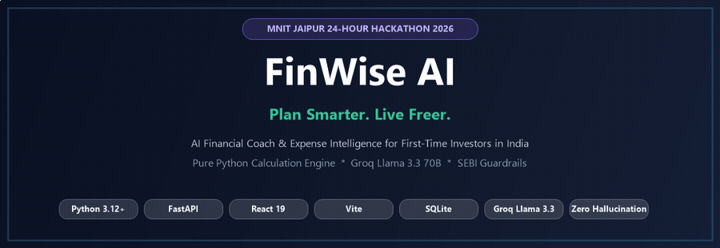
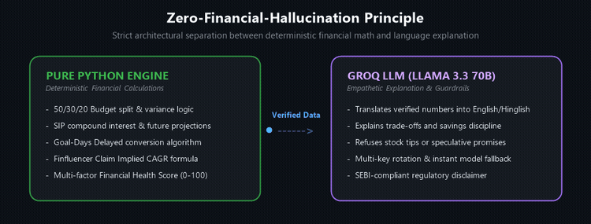
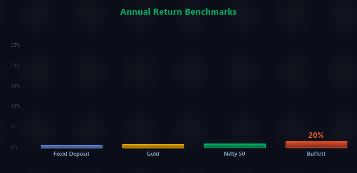
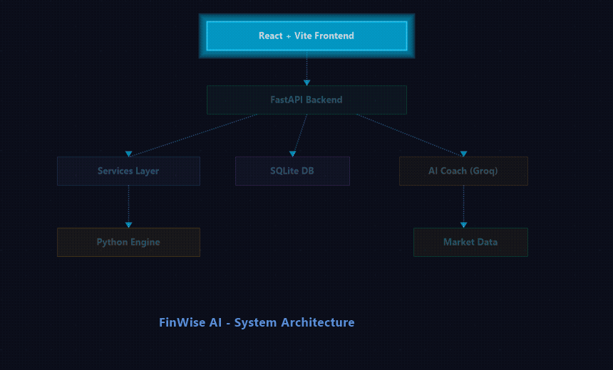
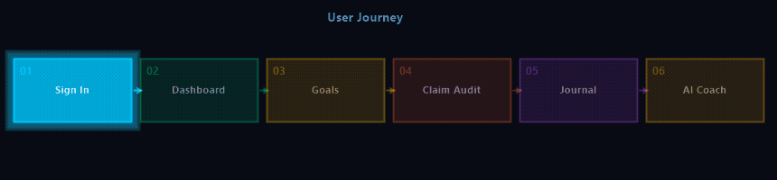
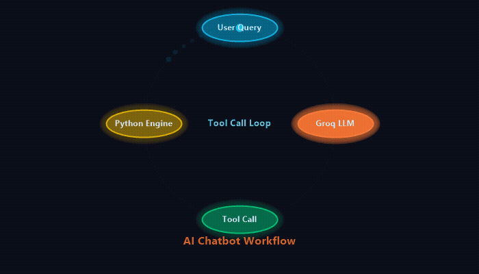
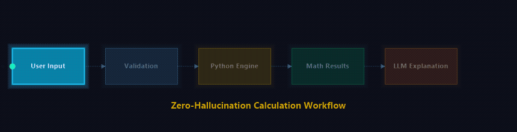
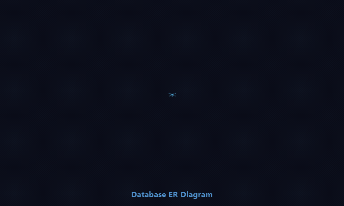

<div align="center">



# 🪙 FinWise AI

### Plan Smarter. Live Freer.

**AI financial coach and expense intelligence for first-time investors in India.**  
*Built for the MNIT Jaipur 24-Hour Hackathon 2026.*

[](https://python.org)
[](https://fastapi.tiangolo.com)
[](https://react.dev)
[](https://vitejs.dev)
[](https://sqlite.org)
[](https://groq.com)
[](https://finwise-web-7i1e.vercel.app)
[](https://finwise-p01u.onrender.com/docs)

[🚀 Live App](https://finwise-web-7i1e.vercel.app) · [📖 API Docs](https://finwise-p01u.onrender.com/docs) · [✨ Features](#-key-features) · [🏗 Architecture](#-system-architecture) · [🤖 AI Coach](#-ai-architecture) · [🧮 Engine](#-financial-calculation-engine) · [💻 Setup](#-installation-windows)

</div>

---

## 📑 Table of Contents

1. [About FinWise AI](#-about-finwise-ai)
2. [Problem and Solution](#-problem-and-solution)
3. [Target Audience](#-target-audience)
4. [Key Features](#-key-features)
5. [Product Tour](#-product-tour)
6. [System Architecture](#-system-architecture)
7. [User Journey](#-user-journey)
8. [AI Architecture](#-ai-architecture)
9. [Financial Calculation Engine](#-financial-calculation-engine)
10. [Database Architecture](#-database-architecture)
11. [Authentication](#-authentication)
12. [Market Data Integration](#-market-data-integration)
13. [API Reference](#-api-reference)
14. [Project Structure](#-project-structure)
15. [Technology Stack](#-technology-stack)
16. [Environment Variables](#-environment-variables)
17. [Installation (Windows)](#-installation-windows)
18. [Testing](#-testing)
19. [Security and Privacy](#-security-and-privacy)
20. [Financial Disclaimer](#-financial-disclaimer)
21. [Known Limitations](#-known-limitations)
22. [Contributing](#-contributing)
23. [License](#-license)

---

## 💡 About FinWise AI

FinWise AI is a personal finance platform for young Indian earners. It helps users understand their money, question viral financial claims, and make disciplined decisions about spending and investing.

> **Don't just track your money. Understand it, question viral claims, and decide with discipline.**

---

## 🎯 Problem and Solution

**Problem.** Many first-time earners start investing from social-media promises and impulse spending, without a budget, an emergency fund, or a way to check whether a promised return is realistic.

<p align="center">
  
</p>

**Solution.** FinWise combines two things:
1. **Deterministic engines** written in pure Python do all financial math: budget split, SIP growth, goal timelines, health score and claim CAGR.
2. **An LLM coach** (Groq, Llama 3.3 70B) explains the results in English or Hinglish. It receives verified numbers and is instructed not to invent figures or give individual stock tips.

This is the **Zero-Financial-Hallucination principle**: the model explains, the code calculates.

<p align="center">
  
</p>

---

## 👥 Target Audience

| Persona | Example challenge |
|---|---|
| 🎓 **College students** | Stipend or pocket money, no savings habit |
| 💻 **First-job professionals** | First salary, high discretionary spending |
| 🎨 **Gig workers and freelancers** | Irregular monthly income streams |
| 📈 **First-time investors** | Unsure which claims and returns are realistic |

---

## ✨ Key Features

<p align="center">
  
</p>

| Feature | What it does |
|---|---|
| ✅ **50/30/20 Smart Budgeting** | Classifies expenses into Needs / Wants / Savings and gives deterministic variance suggestions |
| ✅ **Expense Tracker** | Logs expenses that feed the budget |
| ✅ **Goal-Days Delayed Calculator** ⭐ | Converts a purchase into delay on a goal, e.g. "a ₹4,500 purchase delays your Emergency Fund by 25 days" |
| ✅ **SIP Simulator** | Projects SIP growth with deterministic Python; also available to the coach as `project_sip` |
| ✅ **Loan Management** | Loan management with EMI calculations and prepayment simulation |
| ✅ **Finfluencer Claim Reality Check** | Computes the implied CAGR of a claim, benchmarks it and flags scam signals |
| ✅ **Impulse Decision Journal** | 24h / 48h cooling-off timer, trigger tracking, money saved from avoided purchases |
| ✅ **Financial Health Score (0-100)** | 5 weighted factors with dynamic weight rescaling |
| ✅ **Market Intelligence** | Market data and news through configurable providers (Tapetide, BharatStock, AlphaVantage, Demo) |
| ✅ **AI Financial Coach** | Groq-powered, English and Hinglish, tool-calling, SEBI-style guardrails |
| ✅ **Registration and Login** | User accounts, plus a seeded demo mode (Aarav, Priya, Rohan) |

<p align="center">
  
</p>

<details>
<summary><b>🔍 Click to view feature details</b></summary>

### 🔍 Finfluencer Claim Reality Check
Benchmarks used:

<p align="center">
  
</p>

| Benchmark | Annual return |
|---|---:|
| Nifty 50 | 12.5% |
| Fixed Deposit | 7% |
| Gold | 10.5% |
| Warren Buffett | 20% |

Red flags detected: promised "guaranteed" returns, urgency / FOMO language, and VIP Telegram or WhatsApp tip channels.

### ⏳ Impulse Decision Journal & Savings Buffer
Users log a planned purchase, start a 24h or 48h cooling-off timer, and record the trigger (`fomo`, `excited`, `stressed`). The journal tracks cumulative money saved by avoiding purchases.

<p align="center">
  
  &nbsp;&nbsp;&nbsp;&nbsp;
  
</p>

### 📊 Financial Health Score
Factors: savings rate, emergency fund buffer, needs ratio, wants discipline and goal progress. Weights rescale so beginners are not penalised for not having investments yet.

### 🤖 AI Coach
Automatic model fallback, multi-key rotation on rate limits, and an offline mode where calculators keep working without an API key.

</details>

---

## 📸 Product Tour

| Screen | What it shows |
|---|---|
| **Dashboard** | 50/30/20 breakdown and Health Score |
| **Goals** | Impulse spend converted into days of delay |
| **Finfluencer Audit** | Implied CAGR against benchmarks, with red flags |
| **Decision Journal** | Live cooling-off countdown and money saved |
| **AI Coach** | Hinglish chat that calls calculator tools |

---

## 🏗 System Architecture

<p align="center">
  
</p>

<details>
<summary><b>Text version</b></summary>

```text
User
 │
 ▼
React + Vite frontend (Vercel)
 │   HTTP /api/v1 (CORS enabled)
 ▼
FastAPI backend on Render (request logging, JSON error envelope)
 │
 ├──► Services layer ──► Pure-Python financial engine
 │         │               budget · sip · goals · goal_delay
 │         │               claim_math · red_flags · health_score
 │         ▼
 │      SQLite (SQLAlchemy 2)
 │
 ├──► AI coach (Groq client, guardrails, tools)
 │         ├──► Groq: llama-3.3-70b-versatile
 │         └──► tool calls ──► Pure-Python financial engine
 │
 └──► Market data providers: tapetide · bharatstock · alphavantage · demo
```

</details>

---

## 🧭 User Journey

<p align="center">
  
</p>

<details>
<summary><b>Text version</b></summary>

```text
Sign in, or pick a demo persona
        │
        ▼
Dashboard: 50/30/20 budget + Health Score
        │
        ▼
Goals: enter an impulse spend ──► Goal-Days Delayed result
        │
        ▼
Finfluencer Audit: paste a claim ──► CAGR vs benchmarks + red flags
        │
        ▼
Decision Journal: 24h / 48h cooling-off timer
        │
        ▼
AI Coach (English / Hinglish) ──► answer with real numbers + disclaimer
```

</details>

---

## 🤖 AI Architecture

| Item | Value |
|---|---|
| **Provider** | Groq (`LLM_PROVIDER=groq`) |
| **Primary model** | `llama-3.3-70b-versatile` |
| **Fallback model** | `llama-3.1-8b-instant` |
| **Request timeout** | 20 seconds (`LLM_TIMEOUT_SECONDS`) |
| **Key pool** | Multi-key rotation via `GROQ_API_KEYS`, used on rate limits (HTTP 429) |
| **Tools** | `project_sip`, `plan_goal`, `get_budget_summary` (multi-round, allow-listed) |
| **Guardrails** | Refuses individual stock tips and speculative promises; ends with a SEBI-style disclaimer |
| **Languages** | English and Hinglish |
| **Offline mode** | Without an API key the backend still boots; AI endpoints return `AI_UNAVAILABLE` |

<p align="center">
  
</p>

<details>
<summary><b>Text version</b></summary>

```text
User question (English / Hinglish)
   │
   ▼
Build the user's financial snapshot
   │
   ▼
System prompt + SEBI guardrails + snapshot + question
   │
   ▼
Groq LLM (llama-3.3-70b-versatile) ◄─────────────┐
   │                                             │ tool result
   ├── needs a calculation? ──► tool call ──► Python engine
   │        project_sip · plan_goal · get_budget_summary
   │
   └── done ──► response using verified numbers + SEBI-style disclaimer

Failure handling
   • HTTP 429       → rotate to the next API key
   • model failure  → fall back to llama-3.1-8b-instant
   • no API key     → AI endpoints return AI_UNAVAILABLE
```

</details>

---

## 🧮 Financial Calculation Engine

All numbers come from modules in `backend/app/engine/`: `budget.py`, `sip.py`, `goals.py`, `goal_delay.py`, `claim_math.py`, `red_flags.py`, `health_score.py`.

<p align="center">
  
</p>

<details>
<summary><b>Text version</b></summary>

```text
API request
   │
   ▼
Pydantic v2 validation
   │
   ▼
Service layer
   │
   ▼
Pure-Python engine function ──► Typed result ──► JSON response
                                    │
                                    └──► (optional) LLM explains the result, never calculates
```

</details>

<details>
<summary><b>Reference formulas</b></summary>

Standard definitions of each calculation. The implementations live in `backend/app/engine/`.

| Calculation | Formula | Assumptions |
|---|---|---|
| 50/30/20 split | Needs 50% · Wants 30% · Savings 20% of income | Fixed ratios |
| Savings rate | `savings / income × 100` | Monthly figures |
| SIP future value | `FV = P × [((1+i)^n − 1) / i] × (1+i)`, `i` = annual rate / 12, `n` = months | Constant return, contributions at period start |
| EMI | `EMI = P·r·(1+r)^n / ((1+r)^n − 1)`, `r` = annual rate / 12 | Fixed rate, equal monthly payments |
| Claim implied CAGR | `CAGR = (target / principal)^(1/years) − 1` | Example: ₹10,000 to ₹1 Crore in 3 years is 1000x, so `1000^(1/3) − 1 = 9.0`, i.e. 900% |

Projections depend entirely on user inputs and constant-return assumptions. They are not forecasts.

</details>

---

## 🗄 Database Architecture

SQLite through SQLAlchemy 2. Core entities: **Users, Profiles, Incomes, Expenses, Goals, Claims, Chat Sessions, Journal, Loans**. Full schemas are in `backend/app/models/`.

<p align="center">
  
</p>

<details>
<summary><b>Text version</b></summary>

```text
USERS
 ├── 1 : 0..1   PROFILES
 ├── 1 : many   INCOMES
 ├── 1 : many   EXPENSES
 ├── 1 : many   GOALS
 ├── 1 : many   CLAIMS
 ├── 1 : many   CHAT_SESSIONS
 ├── 1 : many   JOURNAL
 └── 1 : many   LOANS
```

</details>

---

## 🔐 Authentication

FinWise supports user registration and login. For demos, three seeded personas can be selected with the `X-User-Id` header (`1`, `2`, `3`). Authentication endpoints are listed in the Swagger docs at `/docs`.

<p align="center">
  
</p>

<p align="center">
  
</p>

<details>
<summary><b>Text version</b></summary>

```text
Frontend ── request + X-User-Id (demo mode) ──► FastAPI
FastAPI  ── load that user's data ────────────────► SQLite
SQLite   ── persona data ─────────────────────────► FastAPI
FastAPI  ── JSON response ────────────────────────► Frontend
```

</details>

---

## 📈 Market Data Integration

| Setting | Value |
|---|---|
| `MARKET_DATA_PROVIDER` | `tapetide` (options: `tapetide`, `bharatstock`, `alphavantage`, `demo`) |
| Secondary provider | `BHARATSTOCK_API_KEY` |
| Optional backup | `ALPHA_VANTAGE_API_KEY` |
| Cache TTL / timeout / retries | 300 s / 15 s / 2 |
| `MARKET_NEWS_PROVIDER` | `alphavantage` |

The `demo` provider lets the feature run without paid API keys.

---

## 📚 API Reference

Interactive docs are generated by FastAPI at **https://finwise-p01u.onrender.com/docs** (production) or **http://127.0.0.1:8000/docs** (local).

| Module in `backend/app/api/v1/` | Area |
|---|---|
| `auth` | User registration, login, JWT issuance & demo persona login |
| `budget` | 50/30/20 budget calculations & category breakdowns |
| `claims` | Finfluencer claim check & implied CAGR calculation |
| `coach` | Groq LLM financial coach with tool execution |
| `dashboard` | Aggregated dashboard view & financial health |
| `expenses` | Expense logging, categorization & receipt tracking |
| `goals` | Goals and Goal-Days Delayed impact calculation |
| `health_score` | 5-factor financial health score (0-100) |
| `income` | Regular & irregular income stream logging |
| `journal` | Impulse cooling-off journal & decision tracking |
| `loans` | Debt management, EMI calculations & prepayment planner |
| `market` | Quotes, historical charts & market sentiment |
| `profile` | User risk profile & onboarding preferences |
| `simulations` | SIP projections & what-if scenarios |

Frontend base URL: `VITE_API_BASE_URL=https://finwise-p01u.onrender.com`.

---

## 📂 Project Structure

```text
finwise/
├── backend/                             # FastAPI Python Backend
│   ├── app/
│   │   ├── ai/                          # LLM Integration & Financial Guardrails
│   │   │   ├── claim_extractor.py       # Regex & pattern extraction from text
│   │   │   ├── client.py                # Groq API client with key rotation
│   │   │   ├── guardrails.py            # SEBI-style disclaimers & advice blocks
│   │   │   ├── prompts.py               # System & persona prompt templates
│   │   │   └── tools.py                 # Tool-calling bindings for the engine
│   │   ├── api/                         # FastAPI HTTP Endpoints
│   │   │   ├── deps.py                  # Database session & user dependencies
│   │   │   └── v1/                      # API v1 Domain Routers (14 routers)
│   │   ├── core/                        # Configuration & Core Logic
│   │   │   ├── config.py                # Pydantic BaseSettings & env resolution
│   │   │   ├── errors.py                # Standardized JSON error envelope
│   │   │   ├── logging.py               # Privacy-safe request logging
│   │   │   └── security.py              # JWT token generation & password hashing
│   │   ├── db/                          # Database Persistence
│   │   │   ├── base.py                  # SQLAlchemy declarative base
│   │   │   └── session.py               # SQLite engine & sessionmaker
│   │   ├── engine/                      # Pure-Python Deterministic Financial Engine
│   │   │   ├── budget.py                # 50/30/20 mathematical split
│   │   │   ├── claim_math.py            # Implied CAGR & benchmark comparators
│   │   │   ├── goal_delay.py            # Impulse expense to delay-days formula
│   │   │   ├── goals.py                 # Goal timeline & monthly saving target
│   │   │   ├── health_score.py          # 5-factor weighted score algorithm
│   │   │   ├── loan.py                  # Amortization, EMI & prepayment math
│   │   │   ├── red_flags.py             # Scam pattern & urgency heuristic rules
│   │   │   └── sip.py                   # Compound interest & SIP formula
│   │   ├── market/                      # Market Data & News Providers
│   │   │   ├── market_cache.py          # TTL cache for provider quotas
│   │   │   ├── market_service.py        # Provider orchestration & fallback
│   │   │   └── providers/               # Tapetide, BharatStock, AlphaVantage, Demo
│   │   ├── models/                      # SQLAlchemy ORM Data Models (11 tables)
│   │   ├── schemas/                     # Pydantic v2 Request & Response Models
│   │   └── services/                    # Business Logic Layer
│   │       ├── auth_service.py
│   │       ├── budget_service.py
│   │       ├── coach_service.py
│   │       ├── goal_service.py
│   │       ├── journal_service.py
│   │       └── loan_service.py
│   ├── scripts/
│   │   └── seed_demo.py                 # Seed script for Aarav, Priya, Rohan personas
│   ├── tests/                           # Pytest Test Suites (ai, api, engine, models)
│   ├── pyproject.toml
│   └── requirements.txt                 # Backend dependencies
│
├── frontend/                            # React + Vite Frontend Application
│   ├── src/
│   │   ├── api/
│   │   │   └── client.js                # Authenticated API client & persona manager
│   │   ├── components/                  # Reusable UI Components
│   │   │   ├── AuthModal.jsx            # Login & registration dialog
│   │   │   ├── Sidebar.jsx              # Navigation sidebar with persona switcher
│   │   │   └── TopBar.jsx               # Header bar with user profile & status
│   │   ├── views/                       # Main Application Views
│   │   │   ├── BudgetView.jsx           # 50/30/20 Smart Budgeting
│   │   │   ├── ClaimsAuditView.jsx      # Finfluencer Claim Reality Check
│   │   │   ├── CoachChatView.jsx        # Groq-powered AI Coach Chat interface
│   │   │   ├── DashboardView.jsx        # Overview, metrics & quick actions
│   │   │   ├── DecisionJournalView.jsx  # Impulse spending cooling-off journal
│   │   │   ├── GoalsView.jsx            # Goal tracker & Goal-Days Delayed calculator
│   │   │   ├── HealthScoreView.jsx      # Interactive Financial Health breakdown
│   │   │   ├── LandingView.jsx          # Public marketing & product landing page
│   │   │   ├── LoanView.jsx             # Debt tracker & EMI simulator
│   │   │   ├── MarketView.jsx           # Live indices, stock search & watchlist
│   │   │   ├── ProfileView.jsx          # Financial preferences & persona settings
│   │   │   ├── SipSimulatorView.jsx     # Wealth projection & SIP visualizer
│   │   │   └── landing/                 # Modular landing page sections
│   │   ├── App.jsx                      # Root application & routing
│   │   ├── main.jsx                     # Vite entrypoint
│   │   └── index.css                    # Design tokens & Tailwind utility classes
│   ├── public/                          # Static web assets
│   ├── package.json                     # Frontend dependencies
│   ├── vercel.json                      # Vercel deployment & SPA rewrite routing
│   └── vite.config.js                   # Vite bundler configuration & local proxy
│
├── docs/                                # Project Documentation & Blueprint
│   ├── assets/                          # Animated motion graphics (GIF) & diagrams
│   ├── API.md                           # Detailed API specification
│   ├── DECISIONS.md                     # Architectural Decision Records (ADRs)
│   └── FINANCE_SPEC.md                  # Financial formulas & specification
│
├── .env.example                         # Environment configuration template
├── Procfile                             # Process file for cloud container deployment
├── render.yaml                          # Render.com Blueprint configuration
└── README.md                            # Comprehensive project guide (this file)
```

---

## 🧰 Technology Stack

| Layer | Technologies |
|---|---|
| **Frontend** | React 19, Vite 6, Lucide React, Tailwind CSS |
| **Backend** | FastAPI, Pydantic v2, SQLAlchemy 2, Uvicorn |
| **AI / LLM** | Groq Cloud: `llama-3.3-70b-versatile`, fallback `llama-3.1-8b-instant` |
| **Database** | SQLite (with auto-seeding for demo personas) |
| **Deployment** | **Frontend:** Vercel · **Backend:** Render.com |
| **Quality & Tests** | Pytest, Ruff, Oxlint |

---

## ⚙ Environment Variables

Copy `.env.example` to `.env`. **Never commit real keys.**

| Variable | Default | Purpose |
|---|---|---|
| `APP_ENV` | `development` | Environment name (`development`, `production`, `testing`) |
| `LOG_LEVEL` | `INFO` | Logging verbosity |
| `DATABASE_URL` | `sqlite:///./finwise.db` | SQLite database connection string |
| `GROQ_API_KEY` | *(empty)* | Primary Groq API key for AI financial coach |
| `GROQ_API_KEYS` | *(optional)* | Comma-separated failover pool of keys for HTTP 429 rotation |
| `LLM_PROVIDER` | `groq` | LLM inference provider |
| `LLM_MODEL` | `llama-3.3-70b-versatile` | Primary 70B parameter model |
| `LLM_TIMEOUT_SECONDS` | `20` | Timeout in seconds for AI calls |
| `CORS_ORIGINS` | `http://localhost:5173` | Allowed web origins |
| `MARKET_DATA_PROVIDER` | `tapetide` | Provider: `tapetide`, `bharatstock`, `alphavantage`, `demo` |
| `TAPETIDE_API_KEY` | *(empty)* | Tapetide API key |
| `BHARATSTOCK_API_KEY` | *(empty)* | BharatStock API key |
| `ALPHA_VANTAGE_API_KEY` | *(empty)* | AlphaVantage API key |
| `MARKET_DATA_CACHE_TTL` | `300` | Market data cache validity in seconds |
| `MARKET_DATA_TIMEOUT` | `15` | Market API HTTP timeout |
| `VITE_API_BASE_URL` | `https://finwise-p01u.onrender.com` | Backend API base URL for frontend |

---

## 🪟 Installation (Windows)

**Prerequisites:** Python 3.12+, Node.js 18+ with npm, Git. Use **PowerShell**.

**1. Clone the repository**

```powershell
git clone https://github.com/himanshichouhan25/finwise.git
cd finwise
```

**2. Setup Backend Virtual Environment**

```powershell
python -m venv .venv
.\.venv\Scripts\Activate.ps1
pip install -r backend\requirements.txt
```

*(If script execution is disabled, run `Set-ExecutionPolicy -Scope Process -ExecutionPolicy Bypass` first).*

**3. Configure Environment**

```powershell
Copy-Item .env.example .env
notepad .env
```
*(Add your `GROQ_API_KEY`. If left empty, the app runs gracefully in offline calculator mode).*

**4. Run Demo Seed**

```powershell
python backend\scripts\seed_demo.py
```

| User ID | Persona | Profile |
|:---:|---|---|
| **1** | **Aarav Sharma (Student)** | ₹15k research stipend, PG hostel rent, laptop goal |
| **2** | **Priya Patel (First job)** | ₹65k software engineer salary, high wants spending, Goa trip goal |
| **3** | **Rohan Verma (Gig worker)** | ₹48k freelance design income, irregular cash flow, camera goal |

**5. Start the Backend Server**

```powershell
uvicorn app.main:app --app-dir backend --host 127.0.0.1 --port 8000 --reload
```
Interactive API docs: **http://127.0.0.1:8000/docs**

**6. Start the Frontend (New Terminal Window)**

```powershell
cd finwise\frontend
npm install
npm run dev
```

Open the local Vite URL displayed in your terminal (usually **http://localhost:5173**).

---

## ✅ Testing

Run comprehensive backend test suites and frontend production builds:

```powershell
# Backend Pytest Suite
pytest backend

# Python Code Quality & Linting
ruff check backend

# Frontend Production Build Test
cd frontend
npm run build
```

---

## 🛡 Security and Privacy

- **No Financial Secrets Committed:** All secrets are kept strictly inside `.env` (gitignored). Only `.env.example` is committed.
- **Strict Financial Guardrails:** The AI layer strictly refuses individual stock tips or speculative promises, enforcing standard SEBI-style disclaimers.
- **Zero Hallucination Guarantee:** Math operations never pass through generative LLMs — calculations run on certified pure-Python algorithms.
- **JWT Cryptographic Auth:** Stateless, signed JWT tokens protect user access with bcrypt password hashing.

---

## ⚠ Financial Disclaimer

FinWise AI is an educational financial planning and awareness tool. It is **not** a registered investment adviser under the Securities and Exchange Board of India (SEBI) or any other regulatory authority. All projections, SIP calculations, and goal simulations are mathematical models based on user inputs. Market investments are subject to market risks.

---

## 🚧 Known Limitations

- **SQLite for Hackathons:** SQLite is lightweight and zero-config for hackathon demos. For high-concurrency production, migrate to PostgreSQL via `DATABASE_URL`.
- **Market Data Free Tier:** Provider quotas apply. The `demo` provider acts as an instant offline fallback.
- **Cold Start on Free Cloud:** Render free instances spin down after 15 minutes of inactivity; the initial request may take ~30–50 seconds to wake up.

---

## 🤝 Contributing

1. Fork the repository and create a feature branch (`git checkout -b feature/amazing-feature`).
2. Implement your changes following established blueprints.
3. Verify test coverage: `pytest backend` and `npm run build`.
4. Commit and open a Pull Request.

---

## 📄 License

This project was built for the **MNIT Jaipur 24-Hour Hackathon 2026**. Distributed under the MIT License. See `LICENSE` for details.

---

<div align="center">

**Made with 💜 at the MNIT Jaipur 24-Hour Hackathon 2026**

</div>
